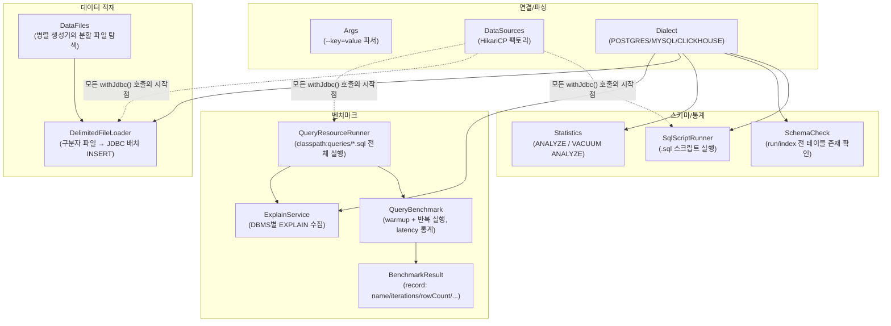
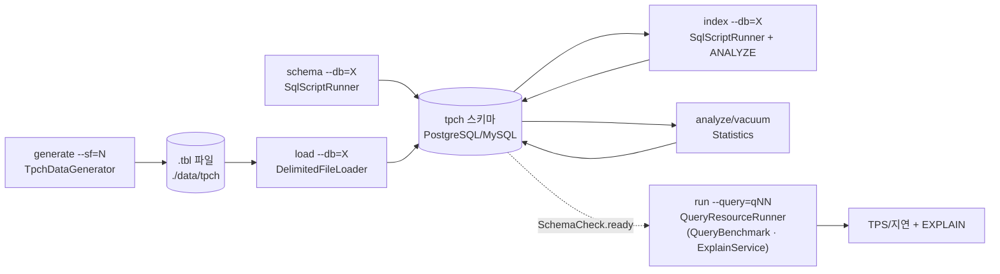
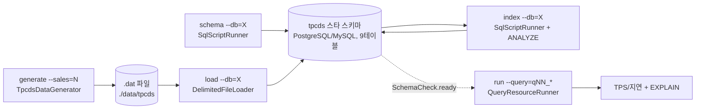
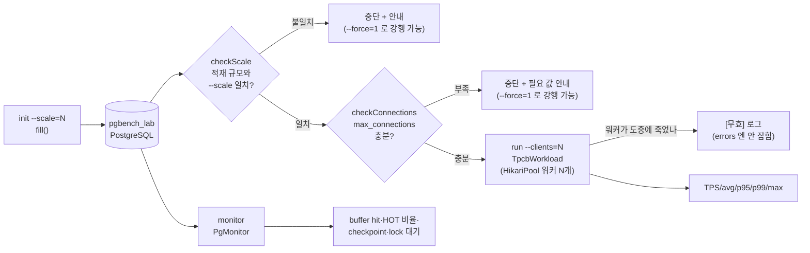
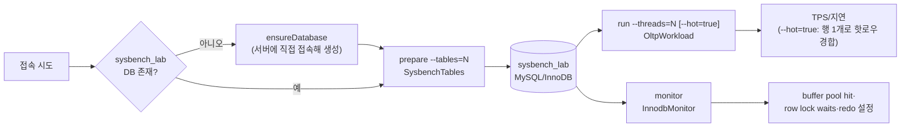
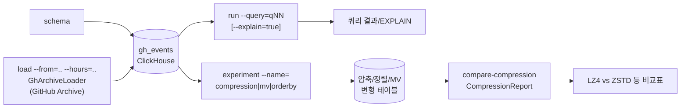
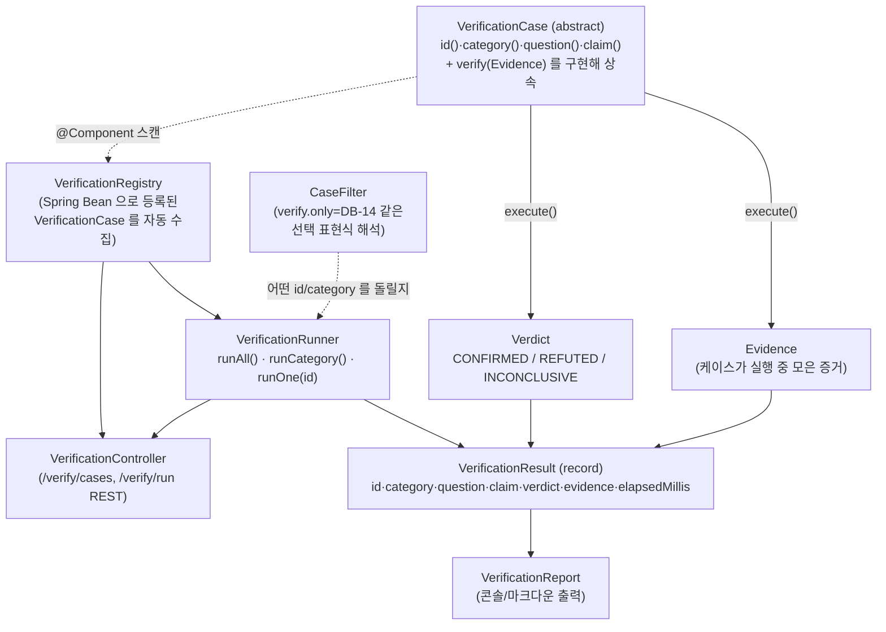
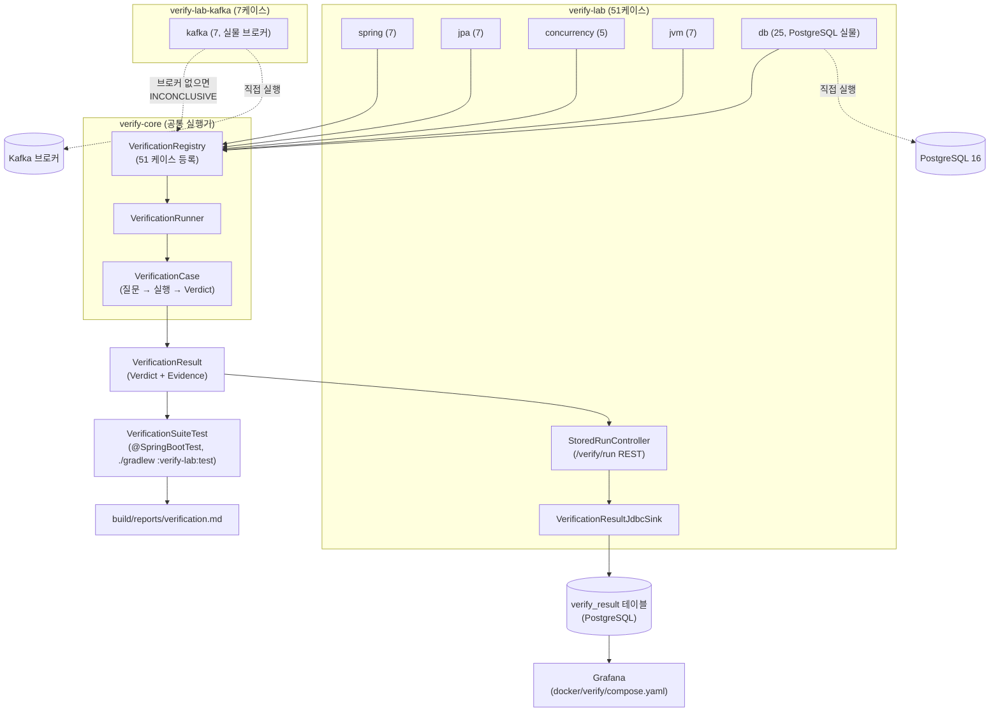
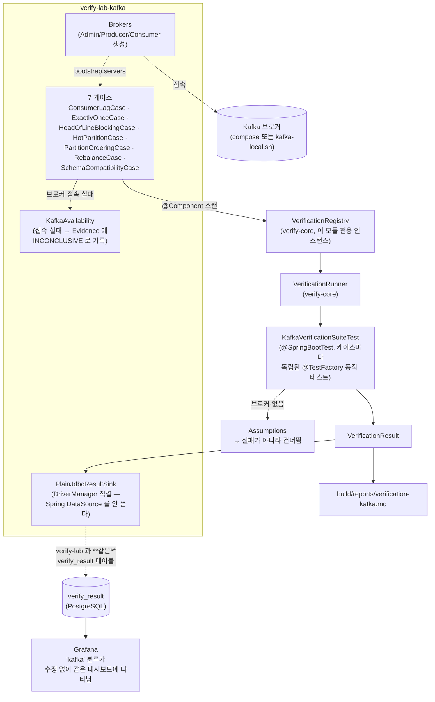

# SQL Tuning Lab

5개 벤치마크 데이터셋(TPC-H, TPC-DS, pgbench, sysbench, GitHub Archive)으로
SQL 튜닝을 연습하는 Spring Boot(Java 17) + Gradle 멀티모듈 프로젝트.

## 벤치마크 개요

| 벤치마크 | 워크로드 | 스키마 | 대상 DB | 모듈 | 1억 건 구성 | RAW 용량 |
|---|---|---|---|---|---|---|
| TPC-H | OLAP / DSS | 3NF, 8 테이블 | PostgreSQL, MySQL | `:tpch` | `dbgen -s 100` (lineitem ~6억) 또는 SF=17 | ~100 GB (SF100) |
| TPC-DS | OLAP / DW | 스노우플레이크 (본 프로젝트는 핵심 9 테이블) | PostgreSQL, MySQL | `:tpcds` | `dsdgen -scale 100` (store_sales ~2.9억) | ~100 GB |
| pgbench | OLTP | 은행 거래 4 테이블 | PostgreSQL | `:pgbench-lab` | `--scale=1000` (accounts 1억) | ~15 GB |
| sysbench | OLTP | sbtest x N | MySQL | `:sysbench-lab` | `--tables=10 --table-size=10000000` | ~24 GB |
| GitHub Archive | Columnar OLAP | 단일 이벤트 로그 | ClickHouse | `:clickhouse-lab` | 약 30일치 로드, 30억+는 공식 s3 | 300 GB+ (전체) |

## DB 접속

```bash
docker exec -it tuninglab-postgres psql -U tuner -d tpch          # tpch | tpcds | pgbench_lab
docker exec -it tuninglab-mysql    mysql -u tuner -ptuner tpch    # tpch | tpcds | sysbench_lab
docker exec -it tuninglab-clickhouse clickhouse-client \
  --user tuner --password tuner --database gharchive
```

> `Unknown database 'tpch'` 가 나오면 **DB 가 아직 없는 것**이다.
> `docker/mysql/init/01-create-databases.sql` 이 만들어 주지만 그건 **볼륨이 비어 있는
> 첫 기동에만** 돈다 — 이미 만들어진 `mysqldata` 볼륨에는 소급되지 않는다.
> `./scripts/restore-lab.sh --mysql` 이 DB 생성부터 적재·인덱스까지 채운다.
>
> `scripts/**/*-mysql.sh` 와 `--mysql` 은 호스트에 `mysql` 클라이언트가 없으면
> `docker exec` 로 넘어간다(psql 쪽과 같다). 컨테이너 이름이 다르면
> `MYSQL_CONTAINER=... ` 로 준다.

한 줄만 실행할 때:

```bash
docker exec tuninglab-postgres psql -U tuner -d tpch -c "SELECT count(*) FROM lineitem"
docker exec tuninglab-clickhouse clickhouse-client --user tuner --password tuner \
  --query "SELECT count() FROM gharchive.github_events"
```

## 요구사항

- Java 17+ (Gradle toolchain이 17 바이트코드로 컴파일)
- Docker + Docker Compose
- 디스크: 소규모 실습 ~5GB / 1억 건 구성 시 벤치마크별 표 참고

## 빠른 시작

```bash
# 1. DB 3종 기동 (PostgreSQL 16, MySQL 8.4, ClickHouse 24.8)
cd docker && docker compose up -d && cd ..

# 2. 빌드
./gradlew build

# 3. TPC-H 예시 (PostgreSQL, 축소 스케일)
./gradlew :tpch:bootRun --args="schema   --db=postgres"
./gradlew :tpch:bootRun --args="generate --sf=0.1"
./gradlew :tpch:bootRun --args="load     --db=postgres"
./gradlew :tpch:bootRun --args="run      --db=postgres --explain=true"   # ① 통계도 인덱스도 없는 상태
./gradlew :tpch:bootRun --args="analyze  --db=postgres"
./gradlew :tpch:bootRun --args="run      --db=postgres --explain=true"   # ② 통계만 갱신한 상태
./gradlew :tpch:bootRun --args="index    --db=postgres"
./gradlew :tpch:bootRun --args="run      --db=postgres --explain=true"   # ③ 인덱스까지 적용
# index 명령은 ANALYZE 도 함께 수행하므로, ①→③ 만 비교하면 두 변수가 섞인다.
# 자세한 실험 설계는 docs 매핑 문서 §T-0, §T-1 참고.
```

> **①(통계 없는 상태)을 재려면 두 가지를 먼저 막아야 한다.** 안 막으면 ①이 조용히 ②가 된다.
>
> - 적재 스크립트가 끝에서 `ANALYZE` 를 돈다 (JDBC `load` 에는 없다).
> - 그걸 피해도 **autovacuum 이 길어야 1분 뒤 통계를 만든다** — 자리를 비우면 ①은 사라져 있다.
>
> COPY 스크립트에 `--no-analyze` 를 주면 **둘 다** 처리한다(ANALYZE 생략 + 대상 테이블 autovacuum off):
> ```bash
> scripts/tpch/load-postgres-copy.sh ./data/tpch --no-analyze   # ① 상태로 적재
> # ... ① 측정 ...
> scripts/tpch/load-postgres-copy.sh --restore-autovacuum        # 끝나면 반드시 원복
> ```
>
> "없음"을 재는 실험은 "있음"을 재는 실험보다 깨지기 쉽다 — 시스템이 알아서 채워 넣기 때문이다.
> 근거와 일반화는 §T-0 ⑥.

모든 모듈은 인자 없이 실행하면 사용법을 출력한다: `./gradlew :tpch:bootRun`

> **`./gradlew build` 가 `:verify-lab:test` 에서 실패한다면 — DB 가 없어서다.**
> ```
> VerificationRegistryTest > ... FAILED
>   Caused by: org.hibernate.HibernateException at DialectFactoryImpl.java:191
> ```
> `verify-lab` 의 테스트는 `@SpringBootTest` 라 JPA 컨텍스트를 띄우고, Hibernate 는 **살아 있는
> JDBC 연결**로 방언(dialect)을 판정한다. `verifylab` DB/계정이 없으면 연결이 실패하고
> "Unable to determine Dialect without JDBC metadata" 로 컨텍스트가 통째로 죽는다.
> 콘솔에는 `DialectFactoryImpl:191` 까지만 보이고 진짜 원인
> (`FATAL: password authentication failed for user "verifylab"`)은 HTML 리포트 안에 있다 —
> `verify-lab/build/reports/tests/test/index.html`.
>
> 고치는 법 — **호스트에서** 실행한다. 컨테이너에 들어갈 필요 없다:
> ```bash
> ./scripts/verify/setup-verifylab.sh          # verifylab DB/계정 생성 (멱등)
> ```
> 호스트에 `psql` 이 있으면 그걸로 붙고, 없거나 접속이 안 되면 `docker exec` 로 컨테이너
> 안의 `psql` 을 쓴다. 어느 경로로 붙었는지 첫 줄에 출력한다.
>
> 슈퍼유저 기본값은 **`tuner`** 다 — compose 의 `POSTGRES_USER` 가 `tuner` 라서 그 인스턴스에는
> `postgres` 롤이 아예 없다. 호스트에 직접 설치한 PostgreSQL 을 쓴다면 `PGSUPER=postgres` 를 준다.
> 접속에 실패하면 무엇을 확인해야 하는지 안내를 출력하고 멈춘다.
>
> PostgreSQL 자체가 안 떠 있다면 `docker compose -f docker/docker-compose.yml up -d postgres`
> (호스트 설치판이면 `./scripts/restore-lab.sh`) 를 먼저 돌린다.
> Kafka 케이스는 브로커가 없으면 실패가 아니라 `SKIPPED` 로 넘어간다(정상).

> **`Failed to exec spawn helper` 로 `bootRun` 이 안 뜬다면 — JDK 가 바뀐 것이다.**
> ```
> Caused by: java.io.IOException: Cannot run program ".../bin/java" ...
>   Failed to exec spawn helper: pid: 1032364, exit code: 1, error: 0 (none)
> ```
> 리눅스에서 JDK 의 기본 프로세스 생성 방식(`POSIX_SPAWN`)은 `$JAVA_HOME/lib/jspawnhelper`
> 를 `exec` 한 뒤 파이프로 **핸드셰이크**를 한다. 실행 중인 JVM 의 `java` 와 디스크의
> `jspawnhelper` 가 **다른 JDK 빌드**면 그 핸드셰이크가 깨진다. 즉 오래 떠 있던 Gradle
> 데몬이 옛 JDK 를 물고 있는데 그 사이 JDK 가 교체된 상황이다. DB 와 무관하다.
>
> ```bash
> ./gradlew --stop          # 데몬 종료 → 다음 실행은 현재 JDK 로 새 JVM
> pkill -f GradleDaemon     # 그래도 남으면
> ./gradlew --no-daemon :tpch:bootRun --args="..."   # 일회성
> ```
>
> **실측 확인**: 실패 직전 실행 로그는 `Java 21.0.12`, 데몬을 내리고 성공한 실행은
> `Java 21.0.12.1` 이었다. 그 사이 JDK 가 in-place 로 올라간 것이 로그에 그대로 남았다.
> 같은 증상이 반복되면 버전 불일치가 아니라 메모리일 수 있으니 `free -h` 를 본다
> (`fork`/`spawn` 은 메모리 압박에서도 실패한다).
>
> 끝까지 안 풀리면 `jspawnhelper` 를 아예 안 쓰게 할 수 있다 — `gradle.properties` 에서:
> ```properties
> org.gradle.jvmargs=-Xmx2g -Dfile.encoding=UTF-8 -Djdk.lang.Process.launchMechanism=vfork
> ```
> `vfork`/`fork` 는 헬퍼를 거치지 않는다(JDK 21 에서 세 방식 모두 동작함을 확인했다).

> **컨테이너·VM 이 재생성된 뒤 복구.** 호스트 설치판(`pg_ctlcluster`)과 Docker판
> (`tuninglab-postgres`) 둘 다 다룬다 — 스크립트가 어느 쪽인지 알아서 판별한다.
> ```bash
> ./scripts/restore-lab.sh --check   # 점검만 (아무것도 바꾸지 않는다)
> ./scripts/restore-lab.sh           # 빠진 것만 복구
> ./scripts/restore-lab.sh --mysql   # **MySQL 쪽** (mt-*-mysql.sh · sysbench 실습용)
> ```
> 클러스터 기동 → 롤 `tuner` → DB `tpch`/`tpcds` → **측정 조건**(`shared_buffers=1GB`,
> `work_mem=64MB`, `max_parallel_workers_per_gather=4`) → 비어 있는 DB 만 재적재 순으로 확인한다.
> **데이터가 있으면 건드리지 않는다.**
>
> 증상이 서로 비슷해 헷갈리므로 대응을 적어 둔다:
>
> | 증상 | 실제 원인 |
> |---|---|
> | `Connection refused` | 클러스터가 down |
> | `password authentication failed for "tuner"` | 롤이 사라짐 |
> | `database "tpcds" does not exist` | DB 가 사라짐 |
> | `relation "store_sales" does not exist` | 데이터만 사라짐 |
> | 측정값이 문서와 배수로 다름 | 서버 설정이 기본값으로 돌아감 |
> | `MySQL 의 tpch.lineitem 이 없습니다` | MySQL 쪽만 안 채워짐 → `--mysql` |
>
> 측정값 항목이 제일 위험하다 — 아무 에러 없이 **숫자만 조용히 틀린다.**
> 실습 잔여물(중간에 끊긴 스크립트가 남긴 `lineitem` 트리거 등)도 함께 경고한다.
> `--mysql` 은 같은 일을 MySQL 에서 한다: 서버 기동 → 계정 권한 → `tpch`/`tpcds`/`sysbench_lab`
> 의 데이터와 **인덱스** → 측정 조건(`innodb_buffer_pool_size` 등) → `mt_n*` 같은 잔여물.

## 모듈별 사용법

### :common — 모든 모듈이 의존하는 공통 유틸

실행형 모듈(`:tpch`/`:tpcds`/`:pgbench-lab`/`:sysbench-lab`/`:clickhouse-lab`) 다섯이
전부 이 모듈 하나에 의존한다. 직접 실행하는 CLI 는 없고, 각 모듈의 `generate → schema →
load → index/analyze → run` 파이프라인이 공통으로 쓰는 부품을 모아 둔 라이브러리다.



### :tpch — 다중 테이블 조인 / 서브쿼리 / 파티셔닝 / Parallel Scan

```bash
./gradlew :tpch:bootRun --args="generate --sf=1 --dir=./data/tpch"   # SF1 = lineitem 600만
./gradlew :tpch:bootRun --args="schema --db=postgres"                # mysql 도 동일
./gradlew :tpch:bootRun --args="load   --db=postgres --dir=./data/tpch"
./gradlew :tpch:bootRun --args="run    --db=postgres --query=q05 --warmup=1 --iterations=3 --explain=true"
./gradlew :tpch:bootRun --args="index  --db=postgres"
```



수록 쿼리: Q1(대량 집계) Q3(3-way 조인+Top-N) Q5(6-way 조인) Q6(범위 스캔)
Q9(LIKE+인라인뷰) Q13(outer join) Q18(IN 서브쿼리+HAVING)

선택도에 따른 Index Scan ↔ Seq Scan 전환점 측정(§T-2)은 스크립트로 자동화되어 있다:

```bash
./scripts/tpch/t2-selectivity-sweep.sh          # 옵티마이저가 선택한 스캔 방식의 변화
./scripts/tpch/t2-selectivity-sweep.sh 4.0      # random_page_cost=4.0 (HDD 가정) 비교
./scripts/tpch/t2-crossover-verify.sh           # 두 방식을 강제 실행해 '진짜 교차점' 측정
./scripts/tpch/t2-index-regression.sh           # 인덱스를 만들었더니 느려진 두 쿼리 (§T-2/T-4)
./scripts/tpch/join-method-compare.sh q03       # 조인 방식(NL/Hash/Merge) 강제 비교 (§T-3)
./scripts/tpch/t6-parallel-decision.sh          # 옵티마이저가 병렬을 고르는/못 고르는 지점 (§T-6)
./scripts/tpch/t8-combined-index.sh             # 조인키+필터 결합 인덱스 (§T-8)
./scripts/tpch/t9-preaggregation.sh             # 반정규화 / 사전 집계와 그 대가 (§T-9)
./scripts/tpch/mt-tenant-isolation.sh           # 멀티테넌시 — 테넌트 키가 팩트에 없을 때 (§X-1)
./scripts/tpch/mt-tenant-isolation-mysql.sh     # 같은 질문을 MySQL/InnoDB 로 (§X-1)
```

> **MySQL 판은 엔진 차이만 재는 실습이다.** 같은 데이터·같은 메모리(buffer pool 1GB)로 맞춰도
> PostgreSQL 에서 나올 수 없는 것이 넷 나온다 — RLS 가 없어 **격리가 정책이 아니라 권한에서**
> 나오고, InnoDB 의 PK 가 클러스터드라 **테넌트를 PK 선두에 두면 6배** 빨라지며(그 대신 테넌트
> 이동이 1.5배 비싸진다), 파티션 키는 **PK 에 반드시 포함돼야 하고**(`ERROR 1503`), 스키마와
> 데이터베이스가 같은 것이라 전략 C 와 D 의 경계가 흐리다.
> `./gradlew :tpch:bootRun --args="load --db=mysql"` 로 적재해 두어야 한다.

§T-9 의 **유지 전략**(비정규화 값을 최신으로 유지하는 방법)은 별도 6종이다.
스키마와 무관한 주제라 tpch 쪽에만 있다:

```bash
./scripts/tpch/t9-trigger-sync.sh               # 트리거 동기화의 쓰기 오버헤드
./scripts/tpch/t9-concurrency.sh                # 동시성에서 드리프트가 생기는 지점
./scripts/tpch/t9-lock-range.sh                 # FOR SHARE 의 락 범위 비용
./scripts/tpch/t9-isolation-levels.sh           # 격리수준을 올리면 — 실패율과 재시도 비용
./scripts/tpch/t9-change-queue.sh               # 변경 큐 + 비동기 전파 (5방식 비교)
./scripts/tpch/t9-queue-tuning.sh               # 워커 수 × 배치 크기 → 지연창
./scripts/tpch/t9-notify-vs-poll.sh             # 폴링/NOTIFY/고정창/적응형/큐깊이 5파 비교
```

> **실험 스크립트 공통 손잡이 — `work_mem`.** `t*` / `join-method-compare` 스크립트는
> 자기가 여는 세션에만 `work_mem=4096MB` 를 건다(`PGOPTIONS`). **서버 기본값은 안 건드린다** —
> 다른 실습의 측정 조건을 바꾸지 않기 위해서다. RAM 이 작은 장비면 낮춰 잡는다:
> `WORK_MEM=512MB ./scripts/tpch/t8-combined-index.sh`
>
> **왜 4GB 인가 — 모자라면 느려지는 게 아니라 계획이 무너지기 때문이다.** `work_mem` 은
> 미리 잡아 두는 양이 아니라 상한이라, 넘칠 일이 없으면 올려도 그대로다(200만 행 tpcds 에서
> 64MB 와 4GB 가 바이트까지 동일). 그래서 작은 데이터에서는 효과가 없다. 문제는 그 다음이다.
>
> `t7` 의 `NOT IN` 은 `work_mem` 이 모자라면 **`hashed SubPlan` 을 포기하고 평범한 `SubPlan`
> 으로 떨어진다** — 해시를 디스크로 흘리는 게 아니라 **바깥 행마다 서브쿼리를 다시 실행**한다.
> 200만 행에서도 약 1초 → **180초 초과**였다. 필요량은 서브쿼리 추정 행수 × 약 17바이트다:
>
> | 팩트 행수 | 필요 `work_mem` | 기본값 64MB 로는 |
> |---|---|---|
> | 200만 | 32 MB | 충분 |
> | 2,880만 (dsdgen SF=10) | **490 MB** | 7.6배 부족 → `SubPlan` 붕괴 |
> | 2.88억 (SF=100) | **4.9 GB** | **4096MB 로도 부족** — 6GB 이상 필요 |
>
> 실제로 2,880만 행에서 이 스크립트가 몇 시간 걸리던 것이 4GB 로 올리자 몇 분에 끝났다.
> `③ UNION` 쪽 유출(약 457만 행부터)은 2배쯤 느려지는 정도라 이에 비하면 사소하다.
>
> **규모를 바꿨으면 먼저 진단한다** — `DIAG=1 ./scripts/tpcds/t7-complex-sql.sh` 가
> 서브플랜 형태·필요 `work_mem`·절별 디스크 유출을 한 번에 보여준다(측정은 건너뛴다).

**1억 건 이상**: `scripts/tpch/gen-official-dbgen.sh 100` (docker로 공식 dbgen 빌드/실행)
→ 대용량 적재는 `scripts/tpch/load-postgres-copy.sh` (COPY, JDBC 대비 5~10배 빠름)
  기본은 적재 후 `ANALYZE` 까지 한다. §T-1 지점 A 를 잴 때만 `--no-analyze` (위 주의 참고)

### :tpcds — Star/눈꽃송이 조인 / 윈도우 함수

```bash
./gradlew :tpcds:bootRun --args="generate --sales=1000000"   # store_sales 100만
./gradlew :tpcds:bootRun --args="schema --db=postgres"
./gradlew :tpcds:bootRun --args="load   --db=postgres"
./gradlew :tpcds:bootRun --args="index  --db=postgres"
./gradlew :tpcds:bootRun --args="run    --db=postgres --explain=true"
```



수록 쿼리: q03(기본 star join) q07(dim 4개) q19(6-way+비등가) q67(윈도우 rank)

> 쿼리 이름이 tpch 와 다르다 — `--query=q03` 은 tpcds 에 없고 `q03_brand_by_year` 로 써야 한다.
> 틀린 이름을 주면 사용 가능한 목록과 함께 실패한다.

스타 스키마용 실험 스크립트 9종. tpch 판과 **결론이 갈리는 지점**이 있어 따로 두었다
(자세한 실측은 매핑 문서 §T-2·§T-4·§T-6~§T-9):

```bash
./scripts/tpcds/t2-selectivity-sweep.sh         # 팩트 직접 vs 차원 경유 — 전환점이 다르다 (§T-2)
./scripts/tpcds/t2-crossover-verify.sh 4        # 강제 실행으로 '진짜 전환점' 측정
./scripts/tpcds/join-method-compare.sh q03_brand_by_year   # 조인 방식 강제 비교 (§T-3·T-5)
./scripts/tpcds/t4-index-defeat.sh              # 인덱스를 무력화하는 5가지 (§T-4)
./scripts/tpcds/t6-query-diagram.sh             # 필터를 약화시키면 진입점이 옮겨간다 (§T-6)
./scripts/tpcds/t7-complex-sql.sh               # 아우터조인 필터위치 / NOT IN / UNION (§T-7)
./scripts/tpcds/t8-combined-index.sh            # 조인키+필터 결합 인덱스 (§T-8)
./scripts/tpcds/t9-preaggregation.sh            # 반정규화 / 사전 집계와 그 대가 (§T-9)
./scripts/tpcds/mt-tenant-isolation.sh          # 멀티테넌시 격리 3전략 비교 — 책 밖 주제 (§X-1)
./scripts/tpcds/mt-tenant-isolation-mysql.sh    # 같은 데이터를 MySQL/InnoDB 로 (§X-1)
```

`mt-tenant-isolation.sh` 는 매장을 테넌트로 삼아 **공유 테이블(+RLS) / LIST 파티션 / 테넌트별
스키마** 를 같은 데이터로 놓고 여섯 가지를 잰다 — 테넌트 조회, RLS 오버헤드, `WHERE` 누락 유출,
교차 테넌트 집계, DDL 팬아웃, 시끄러운 이웃. 파티션은 격리가 아니고, 스키마 분리는 CPU 를
격리하지 않으며, 풀 모델의 진짜 이웃 문제는 흩어짐이라는 것이 실측으로 나온다.

> **tpch 판(`scripts/tpch/mt-tenant-isolation.sh`)은 같은 주제의 다른 질문이다.** tpcds 는
> 테넌트(매장)가 팩트에 **직접** 있어서 바로 전략을 고르면 되지만, tpch 는 테넌트(국가)가
> `lineitem → orders → customer` 로 **2조인 떨어져 있다.** 그래서 RLS 정책을 쓸 컬럼도,
> 파티션 키로 쓸 컬럼도 없고, **비정규화를 먼저 지불해야** 선택지가 열린다.
> 대신 tpcds 에 없던 축이 생긴다 — **테넌트 이동**(고객이 국가를 옮긴다). 거기서는 정규화가
> 압도한다(0.16ms vs 1.1~1.8ms). 두 판을 같이 읽어야 "테넌트 키가 팩트 행에 있는가"가
> 먼저 답해야 할 질문이라는 게 보인다. 자세한 실측은 매핑 문서 §X-1.

> **MySQL 판(`mt-tenant-isolation-mysql.sh`)은 엔진 축을 더해 2×2 를 채운다.** InnoDB 는 PK 가
> 곧 클러스터드 인덱스라, PostgreSQL 이 `CLUSTER`(일회성)로 풀던 흩어짐을 **PK 선두 설계로
> 구조적으로 없앨 수 있다** — 한 매장 전체 집계가 365ms → 51ms. 커버링 인덱스로 같은 값이 나오는
> 것이 비용의 정체가 '클러스터드 인덱스 되찾기'라는 증거다. 다만 이웃 문제는 그래도 안 풀린다 —
> 이웃 1회가 6배 싸졌는데 피해는 오히려 늘었다(싸지면 더 자주 온다). tpch 판에서는 같은 PK 선두
> 결정이 대량 이관 1.5배라는 청구서를 받았지만, tpcds 의 매장은 SCD Type 2 로 안 움직여 그
> 청구서가 없다. **같은 전략이 칸에 따라 최선이기도 손해이기도 하다.**

tpch 에서 얻은 결론을 그대로 옮기면 틀리는 곳이 셋 있다:

| | tpch 결론 | tpcds 실측 |
|---|---|---|
| §T-8 커버링 인덱스 | "②에서 멈춰라 (이득 작음)" | ③이 ②를 **4.1배** 이긴다 (`Heap Fetches: 0`) |
| §T-8 중복 인덱스 | "**좁은** 인덱스를 지워라" | 규칙은 "**작은** 쪽이 이긴다" — PK 를 못 지워도 결합 인덱스가 선택됨 |
| §T-9 MV 유지비 | "접혀 있으니 유지도 쌀 것" | 점 변경 반영이 반정규화의 **38배** (REFRESH 는 증분이 아니다) |

**1억 건 이상**: `scripts/tpcds/gen-official-dsdgen.sh 100 ./data/tpcds 8`
(스케일 100 = store_sales 약 2.9억 건. 이 프로젝트가 쓰는 9개 테이블만 생성하므로 약 40GB,
세 번째 인자는 병렬도. 분할된 `store_sales_1_8.dat` 등은 `load`가 자동 인식한다)
처음이라면 스케일 10(약 2,880만 건, ~4GB)으로 시작하길 권한다.
대용량 적재는 `scripts/tpcds/load-postgres-copy.sh` 가 JDBC 대비 5~10배 빠르다.
기본은 적재 후 `ANALYZE` 까지 하고, §T-1 지점 A 를 잴 때만 `--no-analyze` 를 준다
(위 "빠른 시작"의 주의 참고).
`dsdgen` 은 store_sales 와 함께 store_returns 도 생성하는데, 이 프로젝트 스키마에는
store_returns 가 없어 적재 시 **조용히 무시**된다(오류가 아니다).
WSL에서는 `/mnt/c`, `/mnt/d` 대신 리눅스 네이티브 경로에 생성해야 I/O가 몇 배 빠르다.

### :pgbench-lab — HOT / 인덱스 쓰기 비용 + 서버 지표 관측

```bash
./gradlew :pgbench-lab:bootRun --args="init --scale=10"                       # accounts 100만
./gradlew :pgbench-lab:bootRun --args="reset-stats"
./gradlew :pgbench-lab:bootRun --args="run --clients=8 --seconds=30 --scale=10"
./gradlew :pgbench-lab:bootRun --args="monitor"    # buffer hit / HOT 비율 / checkpoint / 락 대기
```



**1억 건**: `--scale=1000` (Java 적재도 가능하지만 공식이 빠름: `scripts/pgbench/run-official-pgbench.sh init 1000`)

> ⚠️ **`run` 의 `--scale` 은 적재량이 아니라 키를 뽑는 범위다.**
> `aid = 1 + rnd(scale×100000)`, `tid = 1 + rnd(scale×10)`, `bid = 1 + rnd(scale)`.
> 적재된 것과 다르면 **에러 하나 없이 다른 것을 재게 된다** — 어느 방향이든 나쁘다:
>
> - 준 값이 **크면** → 대부분의 UPDATE 가 0행을 맞춘다. 0행 UPDATE 는 에러가 아니므로
>   `errors=0` 에 TPS 도 멀쩡히 찍히는데 사실상 아무 일도 안 한 것이다.
> - 준 값이 **작으면** → 워크로드가 앞쪽 일부에만 몰린다. 캐시에 다 들어가 빨라지고,
>   `branches` 행이 적어져 **행 락 경합**이 생긴다. 유효하지만 **다른 실험**이다.
>   (scale=2000 적재에 `--scale=10` 을 준 실행에서 TPS 가 721 → 1,376 으로 뛰고
>   `pgbench_branches` UPDATE 가 평균 1.51ms 로 `accounts` UPDATE(0.032ms)의 **47배**가 됐다.
>   10개 branch 행을 8 클라이언트가 두고 다퉈서다.)
>
> 이제 `run` 이 적재 규모(`pgbench_branches` 행 수)와 비교해 다르면 멈추고 어느 쪽인지
> 말해 준다. 일부러 어긋나게 돌리려면 `--force=1`.

> **무엇을 잴 수 있고 무엇은 못 재는가** — 제목이 실제보다 많이 약속하고 있어서 고쳐 적는다.
> `run` 의 워크로드는 **TPC-B 한 종류로 고정**이다(3 UPDATE + 1 SELECT + 1 INSERT).
> 손잡이는 `clients` / `seconds` / `scale` 뿐이고, 쿼리를 바꾸려면 `TpcbWorkload.java` 를 고쳐야 한다.
>
> | 주제 | 상태 |
> |---|---|
> | HOT / fillfactor | ✅ `monitor` 의 `n_tup_hot_upd` + `t8-dml-cost.sh` 의 통제 실험 |
> | 인덱스의 쓰기 비용 | ✅ `t8-dml-cost.sh` (§T-8 후반) |
> | WAL flush | ✅ `t-wal-flush.sh` 가 `synchronous_commit` on/off 를 교차 측정한다(아래) |
> | 체크포인트 | ⚠️ `monitor` 가 카운터를 찍는다. 조건을 바꿔 비교하는 실험은 없다 |
> | shared_buffers | ✅ `t-shared-buffers.sh` 가 값을 바꿔 가며 교차 측정한다(아래) |
> | 버퍼 적중률 | ⚠️ `monitor` 의 값은 DB 전체 **누적**이라 한 실행의 측정치가 아니다(`reset-stats` 후에 보라) |
> | B-Tree 페이지 분할 | ❌ **코드가 없다.** `pageinspect` / `bt_page_stats` 를 쓰는 곳이 한 군데도 없다 |
>
> `TpcbWorkload` 주석이 "튜닝 관찰 포인트"로 세 가지를 적어 뒀는데 자동화된 것은 fillfactor 하나다.
> 그리고 거기 적힌 **branches 행 락 경합은 작은 scale 에서만 성립한다** — `scale` 이 크면
> branches 가 `scale` 행이라 8 클라이언트가 같은 행을 칠 일이 거의 없다.

인덱스의 **쓰기 비용**(§T-8 후반)은 스크립트로 자동화되어 있다. pgbench_lab 이 없으면 만든다:

```bash
./scripts/pgbench/t8-dml-cost.sh                # 전부 (scale=10 에서 약 20분)
ONLY=2 ./scripts/pgbench/t8-dml-cost.sh         # fillfactor 절만

./scripts/pgbench/t-shared-buffers.sh           # shared_buffers 는 무엇을 빠르게 하는가
./scripts/pgbench/t-wal-flush.sh                # 커밋이 fsync 를 기다리는 값은 얼마인가
```

> **`synchronous_commit` 은 무엇을 사고 무엇을 파는가.** 클라이언트 수마다 on/off 를 붙여서
> 교차 측정하고, **측정 중 다른 세션에서 `pg_stat_activity` 를 100ms 마다 샘플링**해
> 무엇을 기다렸는지 같이 남긴다. 세션 단위 `SET` 이라 서버 설정도 재시작도 건드리지 않는다.
> scale=10 실측:
>
> | clients | on tps | off tps | off/on | on 쪽 최상위 대기 (2회 실행) |
> |---|---|---|---|---|
> | 1 | 780~820 | 1,186~1,194 | 1.45~1.53배 | `IO.WALSync` 36% / 40% |
> | 2 | 1,476~1,690 | 2,134~2,225 | 1.32~1.45배 | `IO.WALSync` 37% / 35% |
> | 8 | 2,657~2,746 | 4,486~4,769 | 1.63~1.79배 | `IO.WALSync` 19% / `Lock.transactionid` 23% |
>
> **`IO.WALSync` 가 `on` 쪽에만 있다 — 추론이 아니라 관측이다.** 처리량 차이의 원인이
> fsync 라는 것이 여기서 확정된다.
>
> 다만 **8 클라이언트 행은 회차마다 뒤집힌다.** 한 번은 `IO.WALSync`, 다음 실행은
> `Lock.transactionid` 가 최상위였다. 이유가 있다 — fsync 는 동시성이 오르면
> 그룹 커밋으로 분할상환되지만 **행 락은 반대로 심해진다.** 그래서 **WAL 증거는 낮은
> 동시성에서 선명하고 높은 쪽에서 흐려진다.** 스크립트는 전 구간을 훑어 어느 구간에서
> WAL 이 잡혔는지 말하고, 안 잡히면 "관측이 아니라 추론"이라고 못박는다.
> 병목은 없어지지 않고 옮겨 가며, `off` 로 얻을 수 있는 상한도 그 다음 병목이 정한다.
>
> ⚠️ `off` 는 공짜가 아니다. 크래시 시 **마지막 몇 백 ms 의 커밋이 사라진다**(데이터가 깨지는
> 것은 아니다 — 원자성은 유지된다). "커밋했다고 응답했는데 없어도 되는가"를 업무로 판단할
> 설정이지 성능만 보고 켜는 것이 아니다.
>
> 자바 러너로도 한 조건만 돌릴 수 있다: `run --sync-commit=off --clients=8`.

> **`shared_buffers` 를 올리면 빨라지나 — 패턴마다 답이 다르다.** 스크립트가 값을 바꿔 가며
> (ALTER SYSTEM + 재시작, 끝나면 원복) 두 패턴을 따로 잰다. scale=10 실측:
>
> | 패턴 | 18MB → 302MB |
> |---|---|
> | 무작위 점조회 | 95,034 → 107,353 tps (**1.13배**). 읽은 블록은 875,352 → 2 |
> | 전체 스캔 2회차 | 어느 값에서도 16,589 중 **16,461 블록을 다시 읽는다** |
>
> 두 줄 다 상식과 어긋나 보이는데, 둘 다 기전이 있다.
>
> **점조회** — 적중률이 61% → 100% 로 올랐는데 tps 는 1.13배뿐이다. 아낀 시간을 줄어든
> 블록 수로 나누면 **블록당 0.79µs** 다. RAM 은 ~0.1µs, NVMe 는 ~10µs, 디스크는 100µs 이상이니
> 그 읽기는 디스크가 아니라 **OS 페이지 캐시**에서 왔다. `shared_buffers` 는 2차 캐시다 —
> **'적중률이 올랐다'와 '빨라졌다'는 다른 얘기다.** 적중률을 KPI 로 잡으면 이득 없는 튜닝을
> 성공이라고 보고하게 된다. 스크립트가 이 µs 를 계산해서 찍는다.
>
> **전체 스캔** — 표가 `shared_buffers` 의 1/4 을 넘으면 PostgreSQL 은 256KB 짜리 **링 버퍼**만
> 내준다. 큰 스캔이 캐시를 통째로 밀어내지 못하게 막는 장치다. 그래서 첫 스캔이 캐시에
> 아무것도 안 남기고, 129MB 표가 넉넉히 들어갈 302MB 에서도 2회차가 그대로 다시 읽는다.
> **큰 스캔은 `shared_buffers` 로 못 고친다** — 손댈 곳은 버퍼가 아니라 스캔량이다.
>
> ⚠️ 서버 설정을 바꾸고 재시작하므로 **공유 서버에서 돌리지 말 것.** 중단해도 원복한다.
> `postgresql.conf` 를 고쳐도 `ALTER SYSTEM` 이 써 둔 `postgresql.auto.conf` 가 이긴다 —
> 스크립트가 설정이 실제로 먹었는지 확인하고, 안 먹었으면 `sourcefile` 을 찍고 멈춘다.

> **"인덱스를 늘리면 TPS 가 떨어진다"는 절반만 맞다.** 같은 개수를 늘려도 `(filler)` 는 HOT 을
> 안 깨고 `(abalance)` 는 0% 로 무너뜨린다 — 갱신되는 컬럼인가가 먼저다. 그리고 그 비용은
> **TPS 에 거의 안 나타난다**: HOT 이 무너지고 레코드 WAL 이 2배가 되는 동안 TPS 변화는
> 라운드 간 편차 안이다. 전역 지표가 국소 변화를 삼킨 경우라 `n_tup_hot_upd` 와
> `pg_stat_wal` 을 봐야 한다.
>
> **기준선 HOT 비율을 상수로 외우지 마라.** `fillfactor=100` 은 필요조건일 뿐이고, 실제 값은
> **페이지당 갱신 횟수(`tps × SECS ÷ 힙 페이지 수`)** 가 정한다. 같은 scale=10 에서도
> `SECS=6` 이면 42%, `SECS=45` 면 89% 가 나오고, `scale=2000` 에서는 0.1% 였다.
> 너무 짧게 재면 표가 **거꾸로** 나온다 — HOT 을 깨는 인덱스가 안 깨는 인덱스보다 싸게 보인다.
> 스크립트가 페이지당 갱신을 찍고, 5회에 못 미치면 필요한 `SECS` 를 역산해 알려준다.
> fillfactor 를 100→90 으로 내리면 HOT 이 100% 가 되고, 70 까지 더 내려도 남는 이득이 없다.

실험 아이디어:
- `docker/postgres/postgresql.conf` 의 `shared_buffers` 128MB↔4GB → hit ratio와 TPS
- `synchronous_commit = off` → WAL flush 대기 제거 효과
- `max_wal_size` 를 256MB로 축소 → checkpoint 폭풍을 `monitor` 로 관찰
- 부하 실행 중 별도 셸에서 `monitor` → 락 대기 이벤트 실시간 관찰

### :sysbench-lab — InnoDB Buffer Pool / Lock Contention / Redo Log

```bash
./gradlew :sysbench-lab:bootRun --args="prepare --tables=4 --table-size=100000"
./gradlew :sysbench-lab:bootRun --args="run --threads=8 --seconds=30 --tables=4 --table-size=100000"
./gradlew :sysbench-lab:bootRun --args="run --threads=16 --hot=true --tables=4 --table-size=100000"  # 핫로우 락 경합
./gradlew :sysbench-lab:bootRun --args="monitor"   # buffer pool hit / row lock waits / redo 설정
```



§M-4/M-6/M-7(무릎·커밋 비용·redo 압력)의 MySQL 판은 스크립트로 자동화되어 있다.
`sysbench` 가 없으면 `apt-get install -y sysbench`, 데이터가 없으면 스크립트가 만든다:

```bash
./scripts/sysbench/m4-m7-mysql.sh               # 전부 (약 8분)
ONLY=1 ./scripts/sysbench/m4-m7-mysql.sh        # 무릎 sweep 만
THREADS="1 2 4 8 16 32 64 128 256" ./scripts/sysbench/m4-m7-mysql.sh   # 스레드 목록
```

> **코어가 많으면 기본 목록(…64)으로는 무릎에 닿지 못한다.** CPU 32개 장비에서는 64 까지
> 계속 `TPS× > 지연×` 라 무릎 근처에도 못 간다. 스윕의 마지막 칸에서 최대 TPS 가 나오면
> 스크립트가 **"무릎에 닿지 못했다"** 고 말하고 다음 목록을 제안한다 —
> 그 문장이 없으면 "무릎은 64" 라는 결론이 측정이 아니라 **스윕 길이**에서 나온 것이 된다.
>
> **높은 스레드 수에서는 상한 셋에 걸린다 — 스크립트가 미리 재서 넘겨준다.**
> 클라이언트 쪽 `ulimit -n`(리눅스 기본 soft 1024)은 스레드마다 소켓이 하나라 1024 부터
> 걸린다(`FATAL: error 2004: Can't create TCP/IP socket (24)` — 24는 EMFILE). SQL 로는
> 못 고치므로 스크립트가 **자기 프로세스의 soft 한도를 hard 까지 올린다.**
> 나머지 둘은 서버 쪽이다.
> `max_connections`(기본 151)는 스레드마다 연결이 하나라 256 부터 걸리고
> (`FATAL: error 1040: Too many connections`), `max_prepared_stmt_count`(기본 16382)는
> sysbench 가 **스레드당 준비문을 `9×tables+1` 개**(tables=4 면 37개, 워밍업에서 실측)
> 잡기 때문에 512 부터 걸린다(`FATAL: mysql_stmt_prepare() failed`). 둘 다 스윕 전에 재서
> **이 실행 동안만 올리고 끝나면 되돌린다.** 권한이 없어 못 올리면 잴 수 없는 칸을
> 목록에서 빼고 그 사실을 말한다 — 빈 칸을 남기면 아래 판정이 그걸 "처리량이 줄었다"로 읽는다.

> **무릎은 장비마다 다르다 — 코어 4에서 4~16, 코어 32에서 512(코어 수의 16배).**
> 세 번의 실행이 모두 512 를 가리켰다. 그리고 **스윕을 충분히 길게 밀면 TPS 는 포화가
> 아니라 실제로 꺾인다**(코어 32: 4,959 → 2,431, -51%). 짧은 스윕에서는 포화처럼 보이는
> 구간이 먼저 와서 안 보일 뿐이다 — 읽기가 많아 CPU 가 비는 틈을 추가 스레드가 메우고,
> **그 여유가 다 차야 꺾인다.**
> 커밋 내구성은 MySQL 이 redo·binlog **둘**을 내린다. 둘 다 꺼도 1.12배뿐인데, 쓰기 전용
> 워크로드로 바꾸면 1.84배가 된다 — **배수를 정하는 건 엔진이 아니라 커밋 비중이다**
> (그룹 커밋 가설은 스레드 1과 8이 같은 배수라 기각됐다).
> redo 를 1GB→8MB 로 좁히면 TPS −22% 인데 **max 는 14.5배** 뛴다. 내구성 설정은 끝에 원복한다.

**1억 건**: `--tables=10 --table-size=10000000` (공식: `scripts/sysbench/run-official-sysbench.sh prepare 10 10000000`)

실험 아이디어:
- `docker/mysql/my.cnf` 의 `innodb_buffer_pool_size` 128M↔4G → hit rate와 TPS
- `innodb_flush_log_at_trx_commit` 1↔2↔0 → fsync 비용
- `--hot=true` 로 락 경합 유발 후 `monitor` 의 data_lock_waits 관찰
- `transaction_isolation` REPEATABLE-READ ↔ READ-COMMITTED (gap lock 차이)

### :clickhouse-lab — 컬럼 압축 / Primary Key 정렬 / Materialized View

```bash
./gradlew :clickhouse-lab:bootRun --args="schema"
./gradlew :clickhouse-lab:bootRun --args="load --from=2024-01-01 --to=2024-01-01 --hours=0-5"
./gradlew :clickhouse-lab:bootRun --args="run --explain=true"

# 실험 1: LZ4 vs ZSTD 압축
./gradlew :clickhouse-lab:bootRun --args="experiment --name=compression"
./gradlew :clickhouse-lab:bootRun --args="compare-compression"

# 실험 2: Materialized View 사전 집계
./gradlew :clickhouse-lab:bootRun --args="experiment --name=mv"
./gradlew :clickhouse-lab:bootRun --args="run --query=q02_daily_events"      # 원본
./gradlew :clickhouse-lab:bootRun --args="run --query=mv_daily_repo_stats"   # MV

# 실험 3: ORDER BY(Primary Key) 정렬 비교
./gradlew :clickhouse-lab:bootRun --args="experiment --name=orderby"
```



**1억 건**: 약 30일치 `load --from=2024-01-01 --to=2024-01-30 --hours=0-23` (시간당 10~20만 이벤트)
**30억 건+**: `scripts/clickhouse/load-official-github-events.sh` (공식 s3 스냅샷, 디스크 200GB+)

### :verify-core — 검증 케이스의 공통 실행기

`:verify-lab` 과 `:verify-lab-kafka` 둘 다 이 모듈에 의존한다. DB/브로커 어디에도 직접 붙지
않는 게 설계 원칙이다 — 케이스를 **등록·실행·판정**하는 틀만 제공하고, 실제 실행과 그
결과를 어디에 적재할지는 전적으로 랩(`verify-lab`) 쪽 결정이다(`VerificationResultJdbcSink`
가 `:verify-core` 가 아니라 `:verify-lab` 에 있는 이유).



## :verify-lab — 면접 답변 검증 (51케이스 + Grafana)

`ruke79/problem-solving` 에서 이식한 실행형 검증 랩. 면접 질문 1개 = 검증 케이스 1개로,
답변의 명제를 실제 실행으로 재현한다 — spring 7 · jpa 7 · concurrency 5 · jvm 7 · db(PostgreSQL 16 실물) 25.

```bash
./scripts/verify/setup-verifylab.sh    # verifylab DB/계정 (한 번만)
./gradlew :verify-lab:test             # 51건 전부 (~1분)
./gradlew :verify-lab:test -Dverify.only=DB-14   # 하나만

# Grafana 대시보드 (결과가 verify_result 테이블에 자동 적재된다)
docker compose -f docker/verify/compose.yaml up -d
# → http://localhost:3000 (admin/admin) → "Verification Lab"
```

Kafka 검증(`:verify-lab-kafka`, 실물 브로커 8케이스 중 7건 등록)도 있다 —
`./scripts/verify/kafka-local.sh start` (Docker 없이) 또는 compose 의 kafka 서비스.




자세한 내용: [`verify-lab/README.md`](verify-lab/README.md)

### :verify-lab-kafka — MSA 답변을 실물 브로커로 검증

`verify-lab` 의 MSA 케이스가 브로커를 자바 코드로 흉내 낸 것과 달리, 이 모듈은 같은
명제를 **실제 Kafka 브로커**에 걸어 확인한다. 원래 주제 8개(파티션 순서 보증·컨슈머 랙·
DLQ 재처리·Exactly-Once·리밸런스·오토스케일 한계·핫 파티션·Avro 스키마 호환성) 중
7개가 케이스로 구현돼 있다(리밸런스와 오토스케일 한계가 `RebalanceCase` 하나로 묶였다).

```bash
# 브로커: 도커 또는 로컬 KRaft (둘 중 하나)
docker compose -f docker/verify/compose.yaml up -d kafka
./scripts/verify/kafka-local.sh start          # Docker 없이

./gradlew :verify-lab-kafka:test               # 브로커 없으면 실패가 아니라 '건너뜀'
./gradlew :verify-lab-kafka:test -Dverify.only=KAFKA-05   # 하나만
```

이 환경 실행 결과: **7건 전부 CONFIRMED** (로컬 KRaft 3.9.1).



### :mysql-osc — 무정지 스키마 변경(온라인 DDL) 실측 — 책 밖 주제 (§X-2)

`ADD COLUMN`은 `ALGORITHM=INSTANT`라 도구가 필요 없지만, **타입을 바꾸는 변경(INT→BIGINT)은
INSTANT도 INPLACE도 거부된다** — gh-ost·pt-online-schema-change가 존재하는 이유 그 자체다.
이 랩은 Docker로 1 primary + 2 replica(정상 1 / `SOURCE_DELAY`로 지연시킨 1)를 띄우고,
1,000만 행에 배경 쓰기 부하를 건 채 네이티브 `ALTER`(COPY)와 gh-ost를 각각 돌려 **쓰기
차단 시간·청크 크기별 백필 처리량·replica lag 쓰로틀 동작**을 잰다.

```bash
./scripts/mysql-osc/setup-topology.sh   # 토폴로지 준비 (기본 1,000만 행)
./scripts/mysql-osc/t-online-ddl.sh     # 전부 (①ADD COLUMN ②네이티브COPY ③gh-ost청크스윕 ④replica lag쓰로틀)
./scripts/mysql-osc/teardown.sh         # 완전히 치운다
```

이 환경 실측(10,000,000행, MySQL 8.4.11): ADD COLUMN(INSTANT) 198ms·공백 71ms,
네이티브 MODIFY(COPY) 29.9초 중 29.8초(100%)가 쓰기 차단, gh-ost는 청크 10,000에서
74,900행/초를 내면서도 cutover 블로킹은 청크 크기와 무관하게 ~900ms대 — COPY 대비
자릿수가 다르다. 정상 replica 대조군은 231.8초에 완료(쓰로틀 0회), 74초 지연시킨
replica 처치군은 450초 타임아웃까지 쓰로틀 449회로 못 끝냈다. 자세한 수치와 겪은
함정(8.4의 `mysql_native_password` 기본 비활성화, gh-ost의 replica 직접 접속 계정
문제, Docker 익명 볼륨 고아 등)은 매핑 문서 **[§X-2](docs/2003-오라일리-튜닝북-실습-매핑.md#x-2--무정지-스키마-변경--intbigint-네이티브-copy-vs-gh-ost)**.

## DB 파라미터 튜닝

- PostgreSQL: `docker/postgres/postgresql.conf` 수정 → `docker compose restart postgres`
- MySQL: `docker/mysql/my.cnf` 수정 → `docker compose restart mysql`
- 각 파일에 실습용 주석(어떤 값을 왜 바꿔보는지)이 달려 있다.

## 튜닝 서적 기반 실습 코스

Dan Tow 《SQL Tuning》, Cary Millsap 《Optimizing Oracle Performance》의 장별 개념을
실행 가능한 실습으로 매핑한 문서: **[docs/2003-오라일리-튜닝북-실습-매핑.md](docs/2003-오라일리-튜닝북-실습-매핑.md)**
(8주 권장 코스와 Oracle 용어 → PostgreSQL/MySQL 대응표 포함)

## 튜닝 시나리오 ↔ 실습 매핑

| 튜닝 주제 (SQL 튜닝 서적 공통 주제) | 실습 위치 |
|---|---|
| 인덱스 설계, 인덱스 유무 비교 | `run` → `analyze` → `run` → `index` → `run` (통계/인덱스 효과 분리) |
| 실행계획 읽기 (EXPLAIN/ANALYZE) | 모든 모듈 `--explain=true` |
| 조인 방식(NL/Hash/Merge)과 조인 순서 | tpch Q3/Q5/Q9, tpcds q19 |
| 서브쿼리 → 조인 변환 | tpch Q18 |
| 옵티마이저 통계 정밀도 | postgresql.conf `default_statistics_target` |
| 정렬/해시 메모리 (work_mem, spill) | tpch Q1, tpcds q67 + `log_temp_files` 로그 |
| 병렬 처리 | postgresql.conf `max_parallel_workers_per_gather` |
| 버퍼 캐시 적중률 | pgbench `monitor`, sysbench `monitor` |
| 커밋/로그 flush 비용 | pgbench(synchronous_commit), sysbench(flush_log_at_trx_commit) |
| 락 경합, 동시성 | pgbench(clients↑), sysbench(`--hot=true`) |
| 컬럼 저장/압축/사전 집계 | clickhouse-lab 실험 1~3 |

## 문제 해결

**`column "x" is of type integer but expression is of type character varying`** (load 시)
PostgreSQL은 `setString()`으로 넘어온 파라미터를 varchar로 확정하므로 integer/date 컬럼에
넣을 수 없다. `DelimitedFileLoader`가 PG에서는 `Types.OTHER`(Oid 미지정)로 바인딩하여
서버가 대상 컬럼 타입을 추론하도록 되어 있다. 직접 로더를 만들 때도 같은 방식을 쓰거나
JDBC URL에 `stringtype=unspecified`를 추가한다.

**`could not create unique index "store_sales_pkey" ... is duplicated`** (tpcds index 시)
한 영수증(ss_ticket_number) 안에 같은 상품(ss_item_sk)이 중복 생성된 경우다.
데이터 생성기가 수정되었으므로 `generate`를 다시 실행해 .dat를 새로 만든 뒤 재적재한다.

**`multiple definition of 'nItemIndex'`** (dbgen/dsdgen 빌드 시)
GCC 10부터 기본값이 `-fno-common`으로 바뀌어, 여러 .c 파일이 같은 전역 변수를 각자 정의하는
2003년대 코드가 링크 단계에서 깨진다. `scripts/`의 생성 스크립트가 컨테이너 안에서
`-fcommon`을 주입한 gcc 래퍼를 PATH 앞에 두어 해결한다(킷의 makefile은 건드리지 않음).
경고(`warning: variable 'r' set but not used`)는 정상이므로 무시해도 된다.

**적재가 너무 느릴 때** — JDBC 배치 대신 COPY를 쓴다:
`scripts/tpch/load-postgres-copy.sh` (5~10배 빠름). 이 속도 차이 자체가
docs 매핑 문서의 §M-9(Array Processing) 실습 소재다.

## 프로젝트 구조

```
common/          공통 유틸 (QueryBenchmark, ExplainService, DelimitedFileLoader, ...)
tpch/            TPC-H  (PostgreSQL/MySQL)
tpcds/           TPC-DS (PostgreSQL/MySQL, store_sales 채널 9 테이블)
pgbench-lab/     pgbench TPC-B 워크로드 (PostgreSQL)
sysbench-lab/    sysbench oltp_read_write 워크로드 (MySQL)
clickhouse-lab/  GitHub Archive (ClickHouse)
verify-core/     면접 답변 검증 공통 (JdbcTemplate 실행기, 결과 적재)
verify-lab/      검증 케이스 51종 (spring/jpa/concurrency/jvm/db(PostgreSQL) + Grafana)
verify-lab-kafka/ 검증 케이스 중 실물 Kafka 브로커 연계분 (7건)
docker/          DB 3종 compose + 튜닝 파라미터 파일
scripts/         공식 도구(dbgen/dsdgen/pgbench/sysbench/s3) 연동 + 튜닝 실습 스크립트
docs/            튜닝 서적 ↔ 실습 매핑, 작업 인계 기록
```



```mermaid
graph TD
    subgraph "Gradle 모듈"
        common["common<br/>(QueryBenchmark · ExplainService ·<br/>DelimitedFileLoader · DataSources)"]
        tpch["tpch<br/>(TPC-H 데이터 생성/적재)"]
        tpcds["tpcds<br/>(TPC-DS 데이터 생성/적재)"]
        pgbench["pgbench-lab<br/>(TPC-B 워크로드)"]
        sysbench["sysbench-lab<br/>(oltp_read_write 워크로드)"]
        clickhouse["clickhouse-lab<br/>(GitHub Archive)"]
        vcore["verify-core<br/>(검증 실행기 공통)"]
        vlab["verify-lab<br/>(검증 케이스 51종, DB 25건)"]
        vkafka["verify-lab-kafka<br/>(실물 Kafka 브로커 7건)"]

        tpch --> common
        tpcds --> common
        pgbench --> common
        sysbench --> common
        clickhouse --> common
        vlab --> vcore
        vkafka --> vcore
    end

    subgraph "DB 3종 (docker/docker-compose.yml)"
        pg[("PostgreSQL 16")]
        my[("MySQL 8.4")]
        ch[("ClickHouse 24.8")]
    end

    kafka[("Kafka<br/>(scripts/verify/kafka-local.sh<br/>또는 docker/verify/compose.yaml)")]

    subgraph "실습 스크립트 (scripts/)"
        s_tpch["scripts/tpch/<br/>t2·t6·t8·t9·mt-* (조인·격리·락·멀티테넌시)"]
        s_tpcds["scripts/tpcds/<br/>t2·t4·t6~t9·mt-* (스타 조인·파티션)"]
        s_pgbench["scripts/pgbench/<br/>t8-dml-cost · t-shared-buffers · t-wal-flush"]
        s_sysbench["scripts/sysbench/<br/>m4-m7-mysql (대기열·커밋·redo)"]
        s_official["scripts/*/gen-official-*, load-*, run-official-*<br/>(공식 dbgen/dsdgen/pgbench/sysbench 연동)"]
        s_osc["scripts/mysql-osc/<br/>setup-topology · t-online-ddl · teardown<br/>(무정지 스키마 변경, §X-2)"]
    end

    docs["docs/2003-오라일리-튜닝북-실습-매핑.md"]

    tpch -. "schema/load/index" .-> pg
    tpch -. "schema/load/index" .-> my
    tpcds -. "schema/load/index" .-> pg
    tpcds -. "schema/load/index" .-> my
    pgbench -- "TPC-B 트랜잭션" --> pg
    sysbench -- "oltp_read_write" --> my
    clickhouse -- "GH Archive 적재/쿼리" --> ch
    vlab -- "verifylab DB 생성 +<br/>51 케이스 실행" --> pg
    vkafka -- "실물 브로커 7건" --> kafka

    s_tpch -. "적재된 TPC-H 스키마에 부하" .-> pg
    s_tpch -. "적재된 TPC-H 스키마에 부하" .-> my
    s_tpcds -. "적재된 TPC-DS 스키마에 부하" .-> pg
    s_pgbench -- "pgbench 공식 바이너리" --> pg
    s_sysbench -- "sysbench 공식 바이너리" --> my
    s_official -. "공식 분포로 재적재" .-> tpch
    s_official -. "공식 분포로 재적재" .-> tpcds

    docs -. "실측값·해석 반영" .-> s_tpch
    docs -. "실측값·해석 반영" .-> s_tpcds
    docs -. "실측값·해석 반영" .-> s_pgbench
    docs -. "실측값·해석 반영" .-> s_sysbench
    docs -. "실측값·해석 반영" .-> s_osc

    s_osc -- "Docker 3컨테이너<br/>(1 primary + 2 replica)" --> my
```

## 참고

- Java 데이터 생성기는 공식 도구와 동일한 **구조/비율**을 만들지만 값 분포는 근사치다.
  실행계획·인덱스·조인·파라미터 튜닝 실습에는 충분하며, 공식 분포가 필요하면 scripts/ 사용.
- 벤치마크 결과 수치는 하드웨어/설정에 따라 크게 달라진다. 항상 "변경 전/후"를 같은 조건에서 비교할 것.
