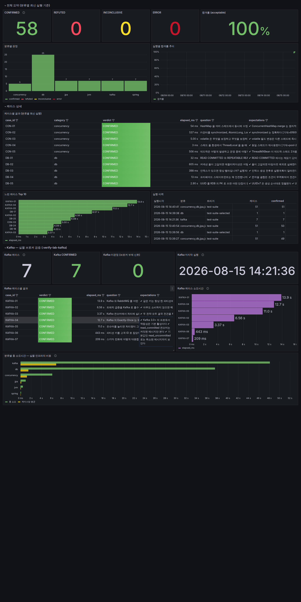

# SQL Tuning Lab

5개 벤치마크 데이터셋(TPC-H, TPC-DS, pgbench, sysbench, GitHub Archive)으로
SQL 튜닝을 연습하는 Spring Boot(Java 17) + Gradle 멀티모듈 프로젝트.

## 벤치마크 개요

| 벤치마크 | 워크로드 | 스키마 | 대상 DB | 모듈 | 1억 건 구성 | RAW 용량 |
|---|---|---|---|---|---|---|
| TPC-H | OLAP / DSS | 3NF, 8 테이블 | PostgreSQL, MySQL | `:tpch` | `dbgen -s 100` (lineitem ~6억) 또는 SF=17 | ~100 GB (SF100) |
| TPC-DS | OLAP / DW | 스노우플레이크 (본 프로젝트는 핵심 9 테이블) | PostgreSQL, MySQL | `:tpcds` | `dsdgen -scale 100` (store_sales ~2.9억) | ~100 GB |
| pgbench | OLTP | 은행 거래 4 테이블 | PostgreSQL | `:pgbench-lab` | `--scale=1000` (accounts 1억) | ~15 GB |
| sysbench | OLTP | sbtest x N | MySQL | `:sysbench-lab` | `--tables=10 --table-size=10000000` | ~24 GB |
| GitHub Archive | Columnar OLAP | 단일 이벤트 로그 | ClickHouse | `:clickhouse-lab` | 약 30일치 로드, 30억+는 공식 s3 | 300 GB+ (전체) |

## DB 접속

```bash
docker exec -it tuninglab-postgres psql -U tuner -d tpch          # tpch | tpcds | pgbench_lab
docker exec -it tuninglab-mysql    mysql -u tuner -ptuner tpch    # tpch | tpcds | sysbench_lab
docker exec -it tuninglab-clickhouse clickhouse-client \
  --user tuner --password tuner --database gharchive
```

한 줄만 실행할 때:

```bash
docker exec tuninglab-postgres psql -U tuner -d tpch -c "SELECT count(*) FROM lineitem"
docker exec tuninglab-clickhouse clickhouse-client --user tuner --password tuner \
  --query "SELECT count() FROM gharchive.github_events"
```

## 요구사항

- Java 17+ (Gradle toolchain이 17 바이트코드로 컴파일)
- Docker + Docker Compose
- 디스크: 소규모 실습 ~5GB / 1억 건 구성 시 벤치마크별 표 참고

## 빠른 시작

```bash
# 1. DB 3종 기동 (PostgreSQL 16, MySQL 8.4, ClickHouse 24.8)
cd docker && docker compose up -d && cd ..

# 2. 빌드
./gradlew build

# 3. TPC-H 예시 (PostgreSQL, 축소 스케일)
./gradlew :tpch:bootRun --args="schema   --db=postgres"
./gradlew :tpch:bootRun --args="generate --sf=0.1"
./gradlew :tpch:bootRun --args="load     --db=postgres"
./gradlew :tpch:bootRun --args="run      --db=postgres --explain=true"   # ① 통계도 인덱스도 없는 상태
./gradlew :tpch:bootRun --args="analyze  --db=postgres"
./gradlew :tpch:bootRun --args="run      --db=postgres --explain=true"   # ② 통계만 갱신한 상태
./gradlew :tpch:bootRun --args="index    --db=postgres"
./gradlew :tpch:bootRun --args="run      --db=postgres --explain=true"   # ③ 인덱스까지 적용
# index 명령은 ANALYZE 도 함께 수행하므로, ①→③ 만 비교하면 두 변수가 섞인다.
# 자세한 실험 설계는 docs 매핑 문서 §T-0, §T-1 참고.
```

> **①(통계 없는 상태)을 재려면 두 가지를 먼저 막아야 한다.** 안 막으면 ①이 조용히 ②가 된다.
>
> - 적재 스크립트가 끝에서 `ANALYZE` 를 돈다 (JDBC `load` 에는 없다).
> - 그걸 피해도 **autovacuum 이 길어야 1분 뒤 통계를 만든다** — 자리를 비우면 ①은 사라져 있다.
>
> COPY 스크립트에 `--no-analyze` 를 주면 **둘 다** 처리한다(ANALYZE 생략 + 대상 테이블 autovacuum off):
> ```bash
> scripts/tpch/load-postgres-copy.sh ./data/tpch --no-analyze   # ① 상태로 적재
> # ... ① 측정 ...
> scripts/tpch/load-postgres-copy.sh --restore-autovacuum        # 끝나면 반드시 원복
> ```
>
> "없음"을 재는 실험은 "있음"을 재는 실험보다 깨지기 쉽다 — 시스템이 알아서 채워 넣기 때문이다.
> 근거와 일반화는 §T-0 ⑥.

모든 모듈은 인자 없이 실행하면 사용법을 출력한다: `./gradlew :tpch:bootRun`

## 모듈별 사용법

### :tpch — 다중 테이블 조인 / 서브쿼리 / 파티셔닝 / Parallel Scan

```bash
./gradlew :tpch:bootRun --args="generate --sf=1 --dir=./data/tpch"   # SF1 = lineitem 600만
./gradlew :tpch:bootRun --args="schema --db=postgres"                # mysql 도 동일
./gradlew :tpch:bootRun --args="load   --db=postgres --dir=./data/tpch"
./gradlew :tpch:bootRun --args="run    --db=postgres --query=q05 --warmup=1 --iterations=3 --explain=true"
./gradlew :tpch:bootRun --args="index  --db=postgres"
```

수록 쿼리: Q1(대량 집계) Q3(3-way 조인+Top-N) Q5(6-way 조인) Q6(범위 스캔)
Q9(LIKE+인라인뷰) Q13(outer join) Q18(IN 서브쿼리+HAVING)

선택도에 따른 Index Scan ↔ Seq Scan 전환점 측정(§T-2)은 스크립트로 자동화되어 있다:

```bash
./scripts/tpch/t2-selectivity-sweep.sh          # 옵티마이저가 선택한 스캔 방식의 변화
./scripts/tpch/t2-selectivity-sweep.sh 4.0      # random_page_cost=4.0 (HDD 가정) 비교
./scripts/tpch/t2-crossover-verify.sh           # 두 방식을 강제 실행해 '진짜 교차점' 측정
./scripts/tpch/join-method-compare.sh q03       # 조인 방식(NL/Hash/Merge) 강제 비교 (§T-3)
./scripts/tpch/t8-combined-index.sh             # 조인키+필터 결합 인덱스 (§T-8)
./scripts/tpch/t9-preaggregation.sh             # 반정규화 / 사전 집계와 그 대가 (§T-9)
```

§T-9 의 **유지 전략**(비정규화 값을 최신으로 유지하는 방법)은 별도 6종이다.
스키마와 무관한 주제라 tpch 쪽에만 있다:

```bash
./scripts/tpch/t9-trigger-sync.sh               # 트리거 동기화의 쓰기 오버헤드
./scripts/tpch/t9-concurrency.sh                # 동시성에서 드리프트가 생기는 지점
./scripts/tpch/t9-lock-range.sh                 # FOR SHARE 의 락 범위 비용
./scripts/tpch/t9-change-queue.sh               # 변경 큐 + 비동기 전파 (5방식 비교)
./scripts/tpch/t9-queue-tuning.sh               # 워커 수 × 배치 크기 → 지연창
./scripts/tpch/t9-notify-vs-poll.sh             # 폴링/NOTIFY/고정창/적응형/큐깊이 5파 비교
```

> **실험 스크립트 공통 손잡이 — `work_mem`.** `t*` / `join-method-compare` 스크립트는
> 자기가 여는 세션에만 `work_mem=4096MB` 를 건다(`PGOPTIONS`). **서버 기본값은 안 건드린다** —
> 다른 실습의 측정 조건을 바꾸지 않기 위해서다. RAM 이 작은 장비면 낮춰 잡는다:
> `WORK_MEM=512MB ./scripts/tpch/t8-combined-index.sh`
>
> **왜 4GB 인가 — 모자라면 느려지는 게 아니라 계획이 무너지기 때문이다.** `work_mem` 은
> 미리 잡아 두는 양이 아니라 상한이라, 넘칠 일이 없으면 올려도 그대로다(200만 행 tpcds 에서
> 64MB 와 4GB 가 바이트까지 동일). 그래서 작은 데이터에서는 효과가 없다. 문제는 그 다음이다.
>
> `t7` 의 `NOT IN` 은 `work_mem` 이 모자라면 **`hashed SubPlan` 을 포기하고 평범한 `SubPlan`
> 으로 떨어진다** — 해시를 디스크로 흘리는 게 아니라 **바깥 행마다 서브쿼리를 다시 실행**한다.
> 200만 행에서도 약 1초 → **180초 초과**였다. 필요량은 서브쿼리 추정 행수 × 약 17바이트다:
>
> | 팩트 행수 | 필요 `work_mem` | 기본값 64MB 로는 |
> |---|---|---|
> | 200만 | 32 MB | 충분 |
> | 2,880만 (dsdgen SF=10) | **490 MB** | 7.6배 부족 → `SubPlan` 붕괴 |
> | 2.88억 (SF=100) | **4.9 GB** | **4096MB 로도 부족** — 6GB 이상 필요 |
>
> 실제로 2,880만 행에서 이 스크립트가 몇 시간 걸리던 것이 4GB 로 올리자 몇 분에 끝났다.
> `③ UNION` 쪽 유출(약 457만 행부터)은 2배쯤 느려지는 정도라 이에 비하면 사소하다.
>
> **규모를 바꿨으면 먼저 진단한다** — `DIAG=1 ./scripts/tpcds/t7-complex-sql.sh` 가
> 서브플랜 형태·필요 `work_mem`·절별 디스크 유출을 한 번에 보여준다(측정은 건너뛴다).

**1억 건 이상**: `scripts/tpch/gen-official-dbgen.sh 100` (docker로 공식 dbgen 빌드/실행)
→ 대용량 적재는 `scripts/tpch/load-postgres-copy.sh` (COPY, JDBC 대비 5~10배 빠름)
  기본은 적재 후 `ANALYZE` 까지 한다. §T-1 지점 A 를 잴 때만 `--no-analyze` (위 주의 참고)

### :tpcds — Star/눈꽃송이 조인 / 윈도우 함수

```bash
./gradlew :tpcds:bootRun --args="generate --sales=1000000"   # store_sales 100만
./gradlew :tpcds:bootRun --args="schema --db=postgres"
./gradlew :tpcds:bootRun --args="load   --db=postgres"
./gradlew :tpcds:bootRun --args="index  --db=postgres"
./gradlew :tpcds:bootRun --args="run    --db=postgres --explain=true"
```

수록 쿼리: q03(기본 star join) q07(dim 4개) q19(6-way+비등가) q67(윈도우 rank)

> 쿼리 이름이 tpch 와 다르다 — `--query=q03` 은 tpcds 에 없고 `q03_brand_by_year` 로 써야 한다.
> 틀린 이름을 주면 사용 가능한 목록과 함께 실패한다.

스타 스키마용 실험 스크립트 9종. tpch 판과 **결론이 갈리는 지점**이 있어 따로 두었다
(자세한 실측은 매핑 문서 §T-2·§T-4·§T-6~§T-9):

```bash
./scripts/tpcds/t2-selectivity-sweep.sh         # 팩트 직접 vs 차원 경유 — 전환점이 다르다 (§T-2)
./scripts/tpcds/t2-crossover-verify.sh 4        # 강제 실행으로 '진짜 전환점' 측정
./scripts/tpcds/join-method-compare.sh q03_brand_by_year   # 조인 방식 강제 비교 (§T-3·T-5)
./scripts/tpcds/t4-index-defeat.sh              # 인덱스를 무력화하는 5가지 (§T-4)
./scripts/tpcds/t6-query-diagram.sh             # 필터를 약화시키면 진입점이 옮겨간다 (§T-6)
./scripts/tpcds/t7-complex-sql.sh               # 아우터조인 필터위치 / NOT IN / UNION (§T-7)
./scripts/tpcds/t8-combined-index.sh            # 조인키+필터 결합 인덱스 (§T-8)
./scripts/tpcds/t9-preaggregation.sh            # 반정규화 / 사전 집계와 그 대가 (§T-9)
./scripts/tpcds/mt-tenant-isolation.sh          # 멀티테넌시 격리 3전략 비교 — 책 밖 주제 (§X-1)
```

`mt-tenant-isolation.sh` 는 매장을 테넌트로 삼아 **공유 테이블(+RLS) / LIST 파티션 / 테넌트별
스키마** 를 같은 데이터로 놓고 여섯 가지를 잰다 — 테넌트 조회, RLS 오버헤드, `WHERE` 누락 유출,
교차 테넌트 집계, DDL 팬아웃, 시끄러운 이웃. 파티션은 격리가 아니고, 스키마 분리는 CPU 를
격리하지 않으며, 풀 모델의 진짜 이웃 문제는 흩어짐이라는 것이 실측으로 나온다.

tpch 에서 얻은 결론을 그대로 옮기면 틀리는 곳이 셋 있다:

| | tpch 결론 | tpcds 실측 |
|---|---|---|
| §T-8 커버링 인덱스 | "②에서 멈춰라 (이득 작음)" | ③이 ②를 **4.1배** 이긴다 (`Heap Fetches: 0`) |
| §T-8 중복 인덱스 | "**좁은** 인덱스를 지워라" | 규칙은 "**작은** 쪽이 이긴다" — PK 를 못 지워도 결합 인덱스가 선택됨 |
| §T-9 MV 유지비 | "접혀 있으니 유지도 쌀 것" | 점 변경 반영이 반정규화의 **38배** (REFRESH 는 증분이 아니다) |

**1억 건 이상**: `scripts/tpcds/gen-official-dsdgen.sh 100 ./data/tpcds 8`
(스케일 100 = store_sales 약 2.9억 건. 이 프로젝트가 쓰는 9개 테이블만 생성하므로 약 40GB,
세 번째 인자는 병렬도. 분할된 `store_sales_1_8.dat` 등은 `load`가 자동 인식한다)
처음이라면 스케일 10(약 2,880만 건, ~4GB)으로 시작하길 권한다.
대용량 적재는 `scripts/tpcds/load-postgres-copy.sh` 가 JDBC 대비 5~10배 빠르다.
기본은 적재 후 `ANALYZE` 까지 하고, §T-1 지점 A 를 잴 때만 `--no-analyze` 를 준다
(위 "빠른 시작"의 주의 참고).
`dsdgen` 은 store_sales 와 함께 store_returns 도 생성하는데, 이 프로젝트 스키마에는
store_returns 가 없어 적재 시 **조용히 무시**된다(오류가 아니다).
WSL에서는 `/mnt/c`, `/mnt/d` 대신 리눅스 네이티브 경로에 생성해야 I/O가 몇 배 빠르다.

### :pgbench-lab — B-Tree Split / Shared Buffers / WAL Flush / HOT

```bash
./gradlew :pgbench-lab:bootRun --args="init --scale=10"                       # accounts 100만
./gradlew :pgbench-lab:bootRun --args="reset-stats"
./gradlew :pgbench-lab:bootRun --args="run --clients=8 --seconds=30 --scale=10"
./gradlew :pgbench-lab:bootRun --args="monitor"    # buffer hit / HOT 비율 / checkpoint / 락 대기
```

**1억 건**: `--scale=1000` (Java 적재도 가능하지만 공식이 빠름: `scripts/pgbench/run-official-pgbench.sh init 1000`)

실험 아이디어:
- `docker/postgres/postgresql.conf` 의 `shared_buffers` 128MB↔4GB → hit ratio와 TPS
- `synchronous_commit = off` → WAL flush 대기 제거 효과
- `max_wal_size` 를 256MB로 축소 → checkpoint 폭풍을 `monitor` 로 관찰
- 부하 실행 중 별도 셸에서 `monitor` → 락 대기 이벤트 실시간 관찰

### :sysbench-lab — InnoDB Buffer Pool / Lock Contention / Redo Log

```bash
./gradlew :sysbench-lab:bootRun --args="prepare --tables=4 --table-size=100000"
./gradlew :sysbench-lab:bootRun --args="run --threads=8 --seconds=30 --tables=4 --table-size=100000"
./gradlew :sysbench-lab:bootRun --args="run --threads=16 --hot=true --tables=4 --table-size=100000"  # 핫로우 락 경합
./gradlew :sysbench-lab:bootRun --args="monitor"   # buffer pool hit / row lock waits / redo 설정
```

**1억 건**: `--tables=10 --table-size=10000000` (공식: `scripts/sysbench/run-official-sysbench.sh prepare 10 10000000`)

실험 아이디어:
- `docker/mysql/my.cnf` 의 `innodb_buffer_pool_size` 128M↔4G → hit rate와 TPS
- `innodb_flush_log_at_trx_commit` 1↔2↔0 → fsync 비용
- `--hot=true` 로 락 경합 유발 후 `monitor` 의 data_lock_waits 관찰
- `transaction_isolation` REPEATABLE-READ ↔ READ-COMMITTED (gap lock 차이)

### :clickhouse-lab — 컬럼 압축 / Primary Key 정렬 / Materialized View

```bash
./gradlew :clickhouse-lab:bootRun --args="schema"
./gradlew :clickhouse-lab:bootRun --args="load --from=2024-01-01 --to=2024-01-01 --hours=0-5"
./gradlew :clickhouse-lab:bootRun --args="run --explain=true"

# 실험 1: LZ4 vs ZSTD 압축
./gradlew :clickhouse-lab:bootRun --args="experiment --name=compression"
./gradlew :clickhouse-lab:bootRun --args="compare-compression"

# 실험 2: Materialized View 사전 집계
./gradlew :clickhouse-lab:bootRun --args="experiment --name=mv"
./gradlew :clickhouse-lab:bootRun --args="run --query=q02_daily_events"      # 원본
./gradlew :clickhouse-lab:bootRun --args="run --query=mv_daily_repo_stats"   # MV

# 실험 3: ORDER BY(Primary Key) 정렬 비교
./gradlew :clickhouse-lab:bootRun --args="experiment --name=orderby"
```

**1억 건**: 약 30일치 `load --from=2024-01-01 --to=2024-01-30 --hours=0-23` (시간당 10~20만 이벤트)
**30억 건+**: `scripts/clickhouse/load-official-github-events.sh` (공식 s3 스냅샷, 디스크 200GB+)

## :verify-lab — 면접 답변 검증 (51케이스 + Grafana)

`ruke79/problem-solving` 에서 이식한 실행형 검증 랩. 면접 질문 1개 = 검증 케이스 1개로,
답변의 명제를 실제 실행으로 재현한다 — spring 7 · jpa 7 · concurrency 5 · jvm 7 · db(PostgreSQL 16 실물) 25.

```bash
./scripts/verify/setup-verifylab.sh    # verifylab DB/계정 (한 번만)
./gradlew :verify-lab:test             # 51건 전부 (~1분)
./gradlew :verify-lab:test -Dverify.only=DB-14   # 하나만

# Grafana 대시보드 (결과가 verify_result 테이블에 자동 적재된다)
docker compose -f docker/verify/compose.yaml up -d
# → http://localhost:3000 (admin/admin) → "Verification Lab"
```

Kafka 검증(`:verify-lab-kafka`, 실물 브로커 8케이스 중 7건 등록)도 있다 —
`./scripts/verify/kafka-local.sh start` (Docker 없이) 또는 compose 의 kafka 서비스.



자세한 내용: [`verify-lab/README.md`](verify-lab/README.md)

## DB 파라미터 튜닝

- PostgreSQL: `docker/postgres/postgresql.conf` 수정 → `docker compose restart postgres`
- MySQL: `docker/mysql/my.cnf` 수정 → `docker compose restart mysql`
- 각 파일에 실습용 주석(어떤 값을 왜 바꿔보는지)이 달려 있다.

## 튜닝 서적 기반 실습 코스

Dan Tow 《SQL Tuning》, Cary Millsap 《Optimizing Oracle Performance》의 장별 개념을
실행 가능한 실습으로 매핑한 문서: **[docs/2003-오라일리-튜닝북-실습-매핑.md](docs/2003-오라일리-튜닝북-실습-매핑.md)**
(8주 권장 코스와 Oracle 용어 → PostgreSQL/MySQL 대응표 포함)

## 튜닝 시나리오 ↔ 실습 매핑

| 튜닝 주제 (SQL 튜닝 서적 공통 주제) | 실습 위치 |
|---|---|
| 인덱스 설계, 인덱스 유무 비교 | `run` → `analyze` → `run` → `index` → `run` (통계/인덱스 효과 분리) |
| 실행계획 읽기 (EXPLAIN/ANALYZE) | 모든 모듈 `--explain=true` |
| 조인 방식(NL/Hash/Merge)과 조인 순서 | tpch Q3/Q5/Q9, tpcds q19 |
| 서브쿼리 → 조인 변환 | tpch Q18 |
| 옵티마이저 통계 정밀도 | postgresql.conf `default_statistics_target` |
| 정렬/해시 메모리 (work_mem, spill) | tpch Q1, tpcds q67 + `log_temp_files` 로그 |
| 병렬 처리 | postgresql.conf `max_parallel_workers_per_gather` |
| 버퍼 캐시 적중률 | pgbench `monitor`, sysbench `monitor` |
| 커밋/로그 flush 비용 | pgbench(synchronous_commit), sysbench(flush_log_at_trx_commit) |
| 락 경합, 동시성 | pgbench(clients↑), sysbench(`--hot=true`) |
| 컬럼 저장/압축/사전 집계 | clickhouse-lab 실험 1~3 |

## 문제 해결

**`column "x" is of type integer but expression is of type character varying`** (load 시)
PostgreSQL은 `setString()`으로 넘어온 파라미터를 varchar로 확정하므로 integer/date 컬럼에
넣을 수 없다. `DelimitedFileLoader`가 PG에서는 `Types.OTHER`(Oid 미지정)로 바인딩하여
서버가 대상 컬럼 타입을 추론하도록 되어 있다. 직접 로더를 만들 때도 같은 방식을 쓰거나
JDBC URL에 `stringtype=unspecified`를 추가한다.

**`could not create unique index "store_sales_pkey" ... is duplicated`** (tpcds index 시)
한 영수증(ss_ticket_number) 안에 같은 상품(ss_item_sk)이 중복 생성된 경우다.
데이터 생성기가 수정되었으므로 `generate`를 다시 실행해 .dat를 새로 만든 뒤 재적재한다.

**`multiple definition of 'nItemIndex'`** (dbgen/dsdgen 빌드 시)
GCC 10부터 기본값이 `-fno-common`으로 바뀌어, 여러 .c 파일이 같은 전역 변수를 각자 정의하는
2003년대 코드가 링크 단계에서 깨진다. `scripts/`의 생성 스크립트가 컨테이너 안에서
`-fcommon`을 주입한 gcc 래퍼를 PATH 앞에 두어 해결한다(킷의 makefile은 건드리지 않음).
경고(`warning: variable 'r' set but not used`)는 정상이므로 무시해도 된다.

**적재가 너무 느릴 때** — JDBC 배치 대신 COPY를 쓴다:
`scripts/tpch/load-postgres-copy.sh` (5~10배 빠름). 이 속도 차이 자체가
docs 매핑 문서의 §M-9(Array Processing) 실습 소재다.

## 프로젝트 구조

```
common/          공통 유틸 (QueryBenchmark, ExplainService, DelimitedFileLoader, ...)
tpch/            TPC-H  (PostgreSQL/MySQL)
tpcds/           TPC-DS (PostgreSQL/MySQL, store_sales 채널 9 테이블)
pgbench-lab/     pgbench TPC-B 워크로드 (PostgreSQL)
sysbench-lab/    sysbench oltp_read_write 워크로드 (MySQL)
clickhouse-lab/  GitHub Archive (ClickHouse)
docker/          DB 3종 compose + 튜닝 파라미터 파일
scripts/         공식 도구(dbgen/dsdgen/pgbench/sysbench/s3) 연동 스크립트
```

## 참고

- Java 데이터 생성기는 공식 도구와 동일한 **구조/비율**을 만들지만 값 분포는 근사치다.
  실행계획·인덱스·조인·파라미터 튜닝 실습에는 충분하며, 공식 분포가 필요하면 scripts/ 사용.
- 벤치마크 결과 수치는 하드웨어/설정에 따라 크게 달라진다. 항상 "변경 전/후"를 같은 조건에서 비교할 것.
